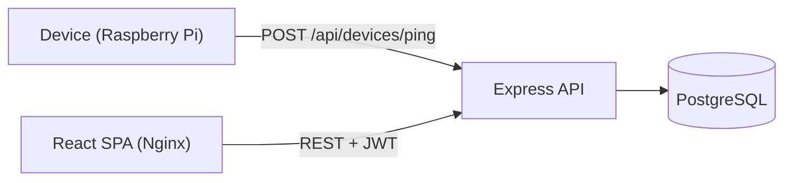
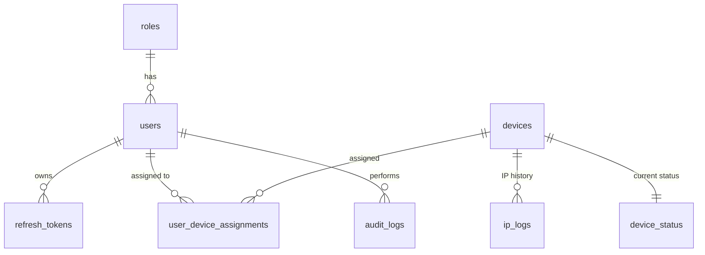

# IP Tracker

[](https://github.com/andresazcona/IP-Tracker/actions/workflows/ci.yml)
[](LICENSE)


A device monitoring system for Raspberry Pi and other IoT hardware whose IP address changes over time. Devices report in with a periodic ping; the service records their public IP, local IP and WiFi network, keeps the IP history and flags devices that stop reporting. It ships with JWT authentication, role-based permissions, device-to-user assignments and an audit log.

## Architecture





## Features

- JWT access and refresh tokens, bcrypt password hashing
- Roles `admin`, `manager`, `user` and `viewer` with per-action permissions (for example `devices.create`)
- Public device ping endpoint that registers or updates a device and logs IP changes
- Online/offline status, computed on demand when devices are listed
- User and device CRUD, bulk assignments, audit log
- React dashboard with periodic refresh and an admin panel
- One-command deployment with Docker Compose

## Quick start

Requires Docker with Compose v2.

```bash
git clone https://github.com/andresazcona/IP-Tracker.git
cd IP-Tracker
cp .env.example .env      # set DB_PASSWORD and JWT_SECRET
docker compose up -d --build
```

- Frontend: http://localhost
- API: http://localhost:3000 (health check at `/health`)
- Default login: `admin` / `admin`. Change it immediately; it is created by `Backend/sql/complete_schema.sql`.

The database schema is applied automatically on the first start of the PostgreSQL container.

### Running without Docker

You need a PostgreSQL 15 database with `Backend/sql/complete_schema.sql` loaded.

```bash
# API on :3000
cd Backend
cp .env.example .env      # set DB_* and JWT_SECRET
npm install
npm run dev

# UI on :5173
cd Frontend
cp .env.example .env
npm install
npm run dev
```

## Configuration

| Variable | Where | Default | Purpose |
| --- | --- | --- | --- |
| `DB_HOST`, `DB_PORT`, `DB_NAME`, `DB_USER`, `DB_PASSWORD` | Backend | `localhost`, `5432`, `ip_tracker`, `postgres`, empty | PostgreSQL connection (or set `DATABASE_URL`) |
| `JWT_SECRET` | Backend | insecure placeholder | Token signing key, always override it |
| `JWT_EXPIRES_IN` / `REFRESH_TOKEN_EXPIRES_IN` | Backend | `1h` / `7d` | Token lifetimes (Compose sets `24h` for access tokens) |
| `PORT` | Backend | `3000` | API port |
| `VITE_API_BASE_URL` | Frontend (build time) | `http://localhost:3000` | API URL used by the browser |

## API

All routes except login, register, refresh and device ping require `Authorization: Bearer <token>`. Full details are in [Backend/README.md](Backend/README.md).

| Area | Routes |
| --- | --- |
| Auth | `POST /api/auth/register`, `login`, `refresh`, `logout`; `GET`/`PUT /api/auth/profile`; `PUT /api/auth/change-password` |
| Users | `GET`/`POST /api/users`; `GET`/`PUT`/`DELETE /api/users/:user_id`; `POST /api/users/:user_id/reset-password`; `GET /api/users/:user_id/devices` |
| Devices | `POST /api/devices/ping` (public); `GET`/`POST /api/devices`; `GET`/`PUT`/`DELETE /api/devices/:device_id` |
| Assignments | `GET`/`POST /api/assignments`; `POST /api/assignments/bulk`; `GET /api/assignments/stats/overview`; `GET`/`PUT`/`DELETE /api/assignments/:assignment_id` |

Example login and device ping:

```bash
curl -X POST http://localhost:3000/api/auth/login \
  -H "Content-Type: application/json" \
  -d '{"username_or_email": "admin", "password": "admin"}'

curl -X POST http://localhost:3000/api/devices/ping \
  -H "Content-Type: application/json" \
  -d '{"device_name": "raspberry-01", "public_ip": "203.0.113.10", "local_ip": "192.168.1.50", "wifi_network": "office"}'
```

## Tests

The API test suite is a Postman collection run with Newman against a live backend and database (39 assertions covering login, user and device CRUD, ping and deletion).

```bash
# With the stack from the quick start running on :3000
cd Backend/newman-tests
npx newman run IP-Tracker-Complete-Tests.postman_collection.json \
  -e IP-Tracker-Environment.postman_environment.json
```

CI runs the same collection against a PostgreSQL service container and also builds the frontend. The frontend has ESLint configured (`npm run lint`) but it is not enforced yet.

## Project structure

```
IP-Tracker/
├── Backend/
│   ├── config/          # CORS, database pool, startup initialization
│   ├── middleware/      # JWT authentication and permission checks
│   ├── routes/          # auth, users, devices, assignments
│   ├── sql/             # PostgreSQL schema and migrations
│   ├── newman-tests/    # Postman collection and environment
│   └── server.js
├── Frontend/
│   ├── src/             # components, contexts, services (Axios client), styles
│   └── nginx.conf
└── docker-compose.yml
```

## Security notes

- Change the default `admin` password and set a strong `JWT_SECRET` (32+ characters) before exposing the service.
- Do not expose PostgreSQL port 5432 publicly; remove the `ports` entry of the `postgres` service in `docker-compose.yml` in production.
- Serve the frontend and API over HTTPS.

## License

[MIT](LICENSE)
